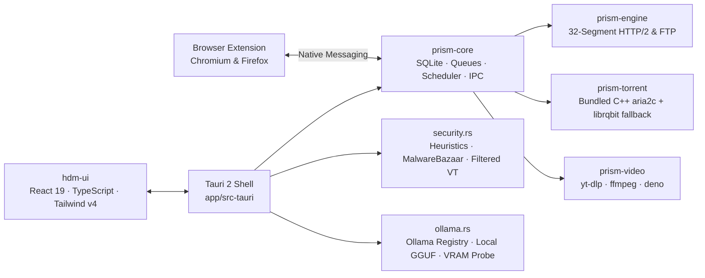

<p align="center">
  
</p>

<h1 align="center">HDM — Houssein Download Manager</h1>

<p align="center">
  <strong>High-velocity, local-first desktop download manager engineered for power users.</strong><br>
  Multi-connection HTTP/FTP · C++ BitTorrent Engine · AI Model Hub · Selective Malware Guard
</p>

<p align="center">
  <a href="LICENSE"></a>
  
  
  
  
</p>

<p align="center">
  <a href="#key-capabilities">Key Capabilities</a> ·
  <a href="#architecture">Architecture</a> ·
  <a href="#selective-malware-guard">Malware Guard</a> ·
  <a href="#bittorrent-engine">BitTorrent Engine</a> ·
  <a href="#keyboard-shortcuts">Shortcuts</a> ·
  <a href="#build--packaging">Build &amp; Packaging</a>
</p>

---

## Overview

**HDM (Houssein Download Manager)** combines a high-throughput Rust download core, a bundled C++ `aria2c` BitTorrent backend, a native **Ollama + Hugging Face AI Model Hub**, and an advisory **Selective Malware Guard** inside a distraction-free **Stealth Obsidian & Crimson** interface.

- **100% Local-First:** No accounts, no cloud sync, no ads, and zero telemetry.
- **Native Performance:** Rust + Tauri 2 desktop runtime with low memory overhead and crash-safe SQLite persistence.
- **Built for Every Workload:** Direct files, remote ZIP inspection, YouTube/1,800+ media sites, BitTorrent swarms, and multi-gigabyte local LLM weights.

---

## Key Capabilities

| Area | Capabilities |
|---|---|
| **Multi-Segment HTTP(S) / FTP** | Up to **32 parallel connections** (`16` default, `64 MiB` adaptive chunks, HTTP/2 multiplexing, `128 MiB` write buffer), crash-safe resume, ETag/Last-Modified validation, and **Remote ZIP Preview** (browse, search, and extract individual files without downloading the full archive). |
| **BitTorrent Engine** | Bundled C++ **`aria2c`** daemon with **MSE/PE protocol encryption**, pure TCP pipelining, `64 MiB` RAM disk cache, **DHT / PEX / LPD**, top-20 public trackers, **outbound-only firewall safety** (zero router ports opened), automatic piece re-verification on resume, **Force Recheck**, **Sequential (Head & Tail First)** mode, per-torrent speed caps, and live tracker re-announce. Automatic fallback to `librqbit`. |
| **AI Model Hub** | Built-in **Ollama Library** and **Hugging Face Hub** browser with automatic **GPU VRAM & system RAM detection**, hardware fit badges, GGUF weight downloads, local model manager, and one-click **Import GGUF into Ollama**. |
| **Selective Malware Guard** | Pre-download URL/filename screening and post-download SHA-256 scanning combining **local static heuristics**, **MalwareBazaar (abuse.ch)**, and optional **VirusTotal** (filtered to ignore harmless `HackTool`/`Crack`/`Keygen` labels). Strictly advisory — you always choose **Keep** or **Delete**. |
| **Video & Audio (`yt-dlp` + `ffmpeg`)** | Download video up to 8K/HDR or extract audio (`MP3`, `M4A`, `Opus`, `FLAC`, `WAV`) across 1,800+ sites with subtitle/chapter/thumbnail embedding and SponsorBlock support. |
| **Queues & Night Scheduler** | Custom queues with concurrency limits, scheduled start/stop windows, **Night Queue** presets, and post-download power actions (`Sleep`, `Hibernate`, `Shutdown`, or custom command) with a cancellable countdown banner. |
| **Telemetry & Verification** | Stable **session-average ETA** (resistant to speed spikes and disk piece-recheck jumps), live throughput sparklines, 32-segment chunk map, built-in 4-stream speed test, and one-click **SHA-256 verification**. |
| **Browser Integration** | Chromium (Chrome, Edge, Brave, Opera, Vivaldi) and Firefox extension via native messaging host for instant download capture and media sniffing. |

---

## Architecture



### Repository Layout

| Path | Description |
|---|---|
| `hdm-ui/` | Custom **Stealth Obsidian & Crimson** React 19 + Tailwind CSS v4 frontend |
| `app/src-tauri/` | Tauri 2 desktop host, IPC commands, `ollama.rs` Model Hub, and `security.rs` Malware Guard |
| `crates/prism-engine/` | Multi-segment HTTP(S)/FTP transfer engine, adaptive chunk scheduler, and buffered disk writer |
| `crates/prism-core/` | Queue manager, SQLite state store, scheduler, batch/site grabber, and browser IPC bridge |
| `crates/prism-torrent/` | BitTorrent facade (`aria2c` JSON-RPC backend + `librqbit` fallback) |
| `crates/prism-video/` | `yt-dlp` / `ffmpeg` toolchain manager, format probing, and muxing pipeline |
| `crates/prism-native-host/` | Native messaging companion binary and cross-browser host registration |
| `extension/` | Browser extension source and Chromium/Firefox build pipeline |
| `packaging/` & `scripts/` | Windows NSIS/MSI hooks, Linux desktop packaging, and portable `.zip` builder |

---

## Selective Malware Guard

HDM's Malware Guard is designed to catch **real threats** without annoying false positives on benign game cracks or utilities:

| Threat Signal | Action | Notes |
|---|---|---|
| **Infostealers, Ransomware, RATs, Keyloggers, Backdoors** | **Flagged (`Harmful`)** | Verified via **MalwareBazaar (abuse.ch)** SHA-256 lookup and optional filtered **VirusTotal** check. |
| **Disguised Double Extensions & Unicode RLO Spoofing** | **Flagged (`Harmful`)** | Catches tricks like `Movie.mp4.exe`, `Guide.pdf.scr`, or BiDi filename spoofing before download starts. |
| **Obfuscated Script Droppers / Shadow-Copy Wipers** | **Flagged (`Harmful`)** | Scans downloaded scripts (`.ps1`, `.bat`, `.vbs`, `.js`, `.hta`) for credential-theft paths, encoded PowerShell cradles, and `vssadmin delete shadows`. |
| **High-Risk Script / Shortcut Types** (`.hta`, `.scr`, `.lnk`, `.vbs`) | **Review (`Caution`)** | Advisory warning before and after download. |
| **Pure `HackTool` / `Crack` / `Keygen` / `Patcher` / `PUA` Labels** | **Ignored (`Clean`)** | Filtered out automatically and reported transparently as *"N crack/hacktool labels ignored"*. |

> **User Control:** Malware Guard **never** auto-deletes files. Every alert presents the exact findings with **Keep File** and **Delete File** controls. Configure auto-scan and an optional free VirusTotal API key under **Settings → Network & Proxy**.

---

## BitTorrent Engine

HDM ships with an isolated, outbound-only **C++ `aria2c`** BitTorrent backend (with automatic `librqbit` fallback):

- **Protocol & Throughput:** Pure TCP pipelining, MSE/PE protocol encryption negotiation, `64 MiB` disk cache, instant NTFS allocation (`--file-allocation=none`), unlimited peer hunting (`--bt-max-peers=0`), DHT (IPv4 + IPv6 bootstrap), PEX, LPD, and 20 built-in public trackers.
- **Firewall Safety:** Strict **outbound-only** posture — zero UPnP and zero router/firewall ports opened. Local JSON-RPC binds exclusively to `127.0.0.1` on an ephemeral port with a per-session random token.
- **Swarm Controls (Settings → BitTorrent & Right-Click Menu):**
  - **Force Recheck:** Hash-verifies existing files on disk and repairs missing/corrupt pieces.
  - **Sequential Download:** Prioritizes head & tail pieces (`32 MiB`) for early media preview.
  - **Per-Torrent Caps & Extra Trackers:** Independent DL/UL caps (`MB/s`) and live tracker re-announce.

---

## Keyboard Shortcuts

| Shortcut | Action |
|---|---|
| `Ctrl + V` | Quick-paste URL, magnet link, YouTube link, or Hugging Face repo |
| `Ctrl + F` | Focus queue search / filter bar |
| `Ctrl + ,` | Toggle **Settings** |
| `Delete` | Remove selected download (opens confirmation modal) |
| `Esc` | Dismiss active modal or context menu |

---

## Build & Packaging

### Prerequisites
- **Rust** `1.88+` (stable toolchain)
- **Node.js** `20+` & **npm**

### 1. Run Test Suites
```bash
# Frontend unit tests (Vitest)
npm --prefix hdm-ui run test

# Frontend typecheck & production bundle
npm --prefix hdm-ui run build

# Rust workspace & app tests
cargo test --release -p prism-torrent
cargo test --release -p prism-app
```

### 2. Build Desktop Installers (Windows)
```bash
npm --prefix hdm-ui install
npm --prefix app install
npm --prefix app run tauri:build
```

Generated artifacts:
- `target/release/hdm.exe` — Standalone executable
- `target/release/bundle/nsis/HDM_0.1.0_x64-setup.exe` — Recommended per-user installer (supports in-place updates)
- `target/release/bundle/msi/HDM_0.1.0_x64_en-US.msi` — Windows Installer package

### 3. Build Windows Portable Archive
```powershell
powershell -ExecutionPolicy Bypass -File .\scripts\make-portable.ps1
```
Outputs `packaging/out/HDM-0.1.0-windows-x64-portable.zip` (self-contained with `portable.txt`, `hdm.exe`, `aria2c.exe`, `prism-native-host.exe`, and browser extensions).

---

## License & Attribution

HDM is open-source software licensed under the **[MIT License](LICENSE)**.

- Core Rust transfer, queue, media, and native-messaging crates build upon the MIT-licensed **[Prism Download Manager](https://github.com/FortoGraphy/prism-download-manager)**.
- BitTorrent swarm backend bundles **[aria2](https://aria2.github.io/)**.
